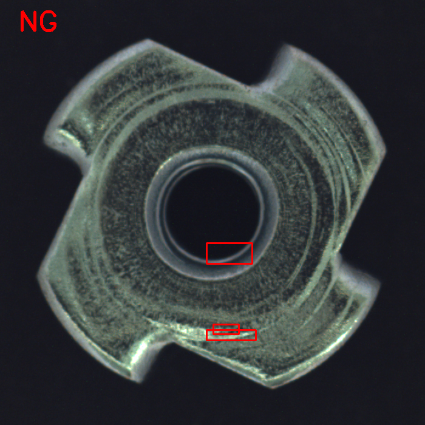
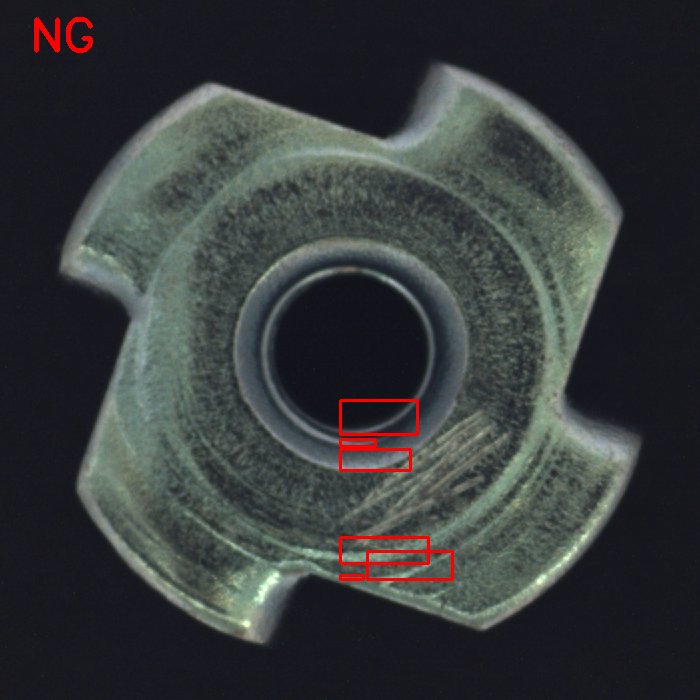

# Industrial 2D Defect Inspection System

C++20과 OpenCV를 활용하여 **MVTec AD Metal Nut** 이미지의 표면 결함을 검사하는 Rule-based 머신비전 프로토타입입니다.

영상처리 기반 결함 후보 검출부터 **Batch Processing, 결과 시각화, CSV Logging, 성능 평가**까지 하나의 C++ 프로그램으로 구현했습니다. 단, 실제 Scratch 위치 검출 및 정상/불량 구분 성능에는 한계가 있어 생산 현장에 바로 적용할 수 있는 수준은 아닙니다.

## 1. Project Overview

| 항목 | 내용 |
|---|---|
| Language | C++20 |
| Computer Vision | OpenCV 4.10 |
| Build / OS | CMake / Ubuntu Linux |
| Dataset | MVTec AD — Metal Nut (`test/good`, `test/scratch`) |
| 검사 방식 | Fixed ROI 기반 Rule-based Image Processing |
| 출력 결과 | 검사 이미지(PNG), CSV Log, 성능 평가 결과(Console) |

### Core Features

- **Image Processing:** ROI 추출, Grayscale, Gaussian Blur, Top-Hat, Otsu Thresholding 적용
- **Defect Candidate Detection:** Contour 검출 후 면적 및 Aspect Ratio 기준으로 후보 필터링
- **Batch Processing:** `good` 및 `scratch` 폴더의 PNG 이미지 일괄 검사와 이미지별 예외 처리
- **Visualization & Evaluation:** Bounding Box, OK/NG 판정, CSV 기록 및 Confusion Matrix 기반 성능 평가

## 2. System Architecture

Batch 실행 및 결과 평가 기능과 영상처리 알고리즘을 분리하여 구성했습니다.

| 구성 파일 | 주요 역할 |
|---|---|
| `src/main.cpp` | 이미지 경로 수집·정렬, 일괄 검사 실행, 결과 저장, 성능 지표 계산 |
| `include/DefectInspector.hpp` | `DefectInspector` 클래스, 검사 설정값 및 `InspectionResult` 구조체 선언 |
| `src/DefectInspector.cpp` | 입력 검증, 영상처리, 결함 후보 검출, Bounding Box 표시, OK/NG 판정 |

### Application Workflow

```text
검사 객체 생성 및 입력 경로 검증
              ↓
     PNG 이미지 경로 수집·정렬
              ↓
        이미지 순차 로드
              ↓
    DefectInspector::inspect()
      (영상처리 및 후보 검출)
              ↓
      InspectionResult 반환
    (결과 이미지, 후보 수, OK/NG)
              ↓
      결과 PNG 및 CSV 저장
              ↓
     검사 건수 및 TP/TN/FP/FN 집계
              ↓
       검사 요약 및 성능 지표 출력
```

카메라에서 실시간 영상을 수집하는 방식이 아니라, 저장된 이미지 파일을 읽어 검사합니다. 생성자에서 검사 설정값을 확인하고, `inspect()`에서 입력 이미지와 ROI의 유효성을 검사합니다.

## 3. Image Processing Pipeline

`DefectInspector::inspect()`에서 실행되는 영상처리 과정입니다.

```text
Input BGR Image
       ↓
Fixed ROI 추출 (x=340, y=400, 180×180)
       ↓
Grayscale → Gaussian Blur (5×5)
       ↓
Morphological Top-Hat (15×15 Rect Kernel)
       ↓
Otsu Thresholding
       ↓
External Contour Detection
       ↓
Contour Filtering
  • Contour Area ≥ 50
  • Bounding Box Width / Height ≥ 2.0
       ↓
원본 이미지에 Bounding Box 표시
       ↓
결함 후보 수 > 0 → NG / 그 외 → OK
```

- **Top-Hat:** 주변보다 밝은 국소 구조를 강조하며, 이 단계만으로 Scratch 여부를 판별하지는 않습니다.
- **Otsu Thresholding:** 처리된 ROI 영상의 픽셀 분포를 기준으로 이진화 임계값을 자동 결정합니다.
- **Contour Filtering:** 면적과 Bounding Box의 가로/세로 비율 조건을 모두 만족하는 후보만 유지합니다. 현재 조건은 가로로 긴 형태에 유리합니다.
- **Bounding Box:** ROI 내부 좌표를 원본 이미지 좌표로 변환한 후 검출 영역을 표시합니다.

**판정 기준:** 필터링 후 남은 결함 후보가 하나라도 있으면 NG로 처리합니다. 검출된 후보가 실제 Scratch라는 의미는 아닙니다.

## 4. Inspection Results

검사 결과 이미지는 `output/batch/`에 저장하고, `output/inspection_log.csv`에는 `Filename`, `DefectCount`, `Judgment`를 기록합니다.

### Good Sample



### Scratch Sample



**빨간색 Bounding Box는 검출된 후보 영역이며, 실제 Scratch 위치가 정확히 검출되었다는 의미는 아닙니다.** NG 판정만으로 결함 위치 검출의 정확성을 보장할 수 없습니다.

## 5. Performance Evaluation

MVTec AD Metal Nut 데이터셋의 **총 45장(Good 22장, Scratch 23장)**을 대상으로 이미지 단위 OK/NG 분류 성능을 평가했습니다.

### Confusion Matrix

| 실제 분류 / 예측 | NG | OK |
|---|---:|---:|
| Scratch | 23 (TP) | 0 (FN) |
| Good | 22 (FP) | 0 (TN) |

### Classification Metrics

| 지표 | 결과 |
|---|---:|
| Accuracy | 51.11% |
| Precision | 51.11% |
| Recall | 100.00% |
| F1 Score | 67.65% |

**결과 해석:** 평가 이미지 45장 모두 NG로 판정되었습니다. 따라서 Recall 100%는 Scratch를 정확하게 구분했다는 뜻이 아닙니다. 정상 이미지 22장도 모두 NG로 잘못 판정되었으며, 실제 Scratch 위치 검출 성능과 이미지 단위 분류 지표는 구분해야 합니다.

이 수치는 데이터셋에서 제공한 Test 이미지에 대한 결과이며, 별도로 확보한 독립 데이터에서의 일반화 성능을 입증하지는 않습니다.

## 6. Limitations & Next Steps

| 확인된 한계 | 개선 방향 |
|---|---|
| **Fixed ROI:** 이미지별 Scratch 위치를 모두 포함하지 못함 | Full Image 검사 또는 Adaptive ROI 적용 검토 |
| **False Positive:** 정상 표면 패턴도 결함 후보로 검출됨 | 전처리 및 후보 필터링 개선, Ground Truth Mask와 비교 |
| **Rule-based Filtering:** 면적과 가로/세로 비율만으로 Scratch 구분이 어려움 | 방향·형태·Texture 특징 및 다른 검출 방법 비교 |

**프로젝트 결과:** C++ 기반 검사 프로그램의 Batch Processing, 결과 저장, 예외 처리 및 정량 평가까지 구현했습니다. 다만 Scratch를 안정적으로 검출하는 문제는 해결되지 않았습니다.

## 7. Project Structure

```text
industrial-defect-inspection/
├── CMakeLists.txt
├── include/
│   └── DefectInspector.hpp
├── src/
│   ├── main.cpp
│   └── DefectInspector.cpp
├── docs/
│   └── images/
│       ├── good-result.png
│       └── scratch-result.png
├── data/                  # 데이터셋 (Git 추적 제외)
├── output/                # 검사 결과 PNG 및 CSV (Git 추적 제외)
└── README.md
```

## 8. Build & Run

**필요 환경:** C++20 지원 컴파일러, CMake, OpenCV

MVTec AD Metal Nut 데이터셋을 별도로 다운로드한 후, 원래 디렉터리 구조를 유지하여 `data/metal_nut/` 아래에 배치합니다. 프로그램은 `test/good/` 및 `test/scratch/` 폴더의 PNG 파일을 읽습니다.

```bash
cmake -S . -B build
cmake --build build
./build/inspection
```

**생성 결과**

- `output/batch/` — Bounding Box와 OK/NG 판정이 표시된 이미지
- `output/inspection_log.csv` — 이미지별 검사 결과
- Console — Batch Summary, Confusion Matrix, Classification Metrics

*데이터셋, 빌드 파일 및 생성된 검사 결과는 Git 버전 관리에서 제외합니다.*
